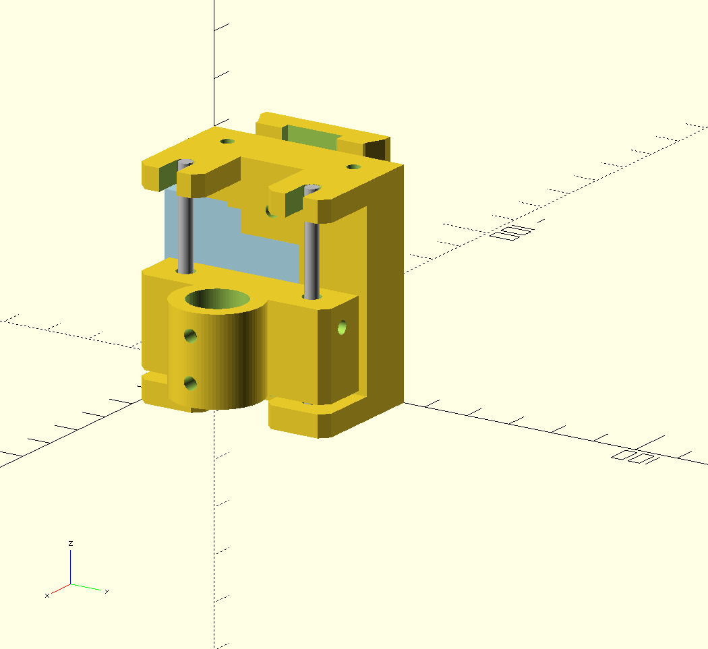

# enPEN - 
Work in Progress!

Direct PEN Replacement for Laserengravers.

This project brings 3d printable parts and Arduino Firmware
for replacing the Laserengraver to a Pen-Plotter.
To add a `z`- Axis this project uses a servo and some easy to build
linear rail mechanism.
The MCU (in this case a Digispark ATtiny85), reads the 5V / 1ms PWM from the Laser-Control-Board and translates it into the servos PWM signal. Thus, when Laser is of, the Pen will be moved up. If Laser is on, the Pen will be moved down. This is a direct replacement.

[Documentation](documentation/project.md)

# LICENSE

<dl>
 Dieses Werk ist lizenziert unter einer <a rel="license" href="http://creativecommons.org/licenses/by/4.0/">Creative Commons Namensnennung 4.0 International Lizenz</a>.
</dl>

<dl>
 This work is licensed under a <a rel="license" href="http://creativecommons.org/licenses/by/4.0/">Creative Commons Attribution 4.0 International License</a>.
</dl>

