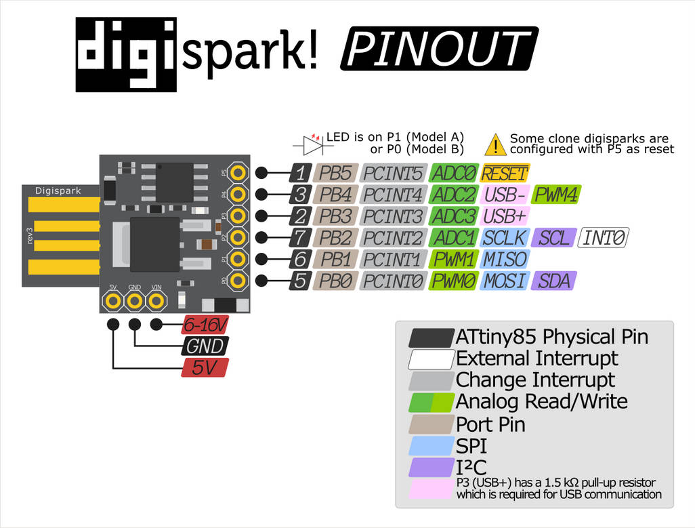

# enPEN - (Digispark ATTiny85 Version)

This small project creates a plug-in __PEN__ replacement for __LASERENGRAVES__ or other CNC machines.

##  Overview
This project contains model files which can be printed and source code for a ATTiny85 MCU which handles translating the Lasers PWM Signal into rising or lowering the pen with a SG90 Servo Motor. This way keeps some flexibility to adjust the behaviour of the pen.
It is also possible to modify G-Code of laser, but I think that is not good and may lead to problems, as the power of the laser varies especially at acceleration or decceleration.
Also this enable some flexibility to play with GCode and PWM translate to the Pen.

## Hardware

- Digispark ATTiny85 (with USB-A Port)
  - up to 16V Input
  - 6V tolerant
  - 2 PWMs / LED onboard
  - all IOs PCINT capable
  - Timer
- MG90 Servo
- Connectors and Cables
- (optional) Switch to decrease PWM Input Voltage
  - if PWM uses 12V

### Power Supply and Signal Connections
- Laser Signal uses usually 12V as Voltage Input, GND and PWM
- PWM Signal must be measured (usually 5V)
  - measured on Longer Ray5 Mini (with 5W Laser)
- Servo is usually 6V tolerant
- __12V Supply to Digispark VIN (6V-16V)__
- __GND to GND__
- __Laser(CNC) PWM to Pin PB1__
- __Servo PWM to Pin PB0__

### Laser Pinout

Connector
-------
| VCC     -> 12V
| GND |   ->  0V
| PWM     ->  5V PWM 
-------

## Software
- Reading in PWM of Laserengraver
  - Sol1:
    - ??using PCINT1 (PB1) as IRQ Source
      - not good... PWM Signal may be complete 0%
    - PB1 is also LED; PWM Signal control by user
    - Trigger on any change
    - Check Pin State
    - Check and store Timer State
  - Sol2:
    - Timer 1/10 ms
    - Sampling PWM input on PB1
      - PB1 is LED; PWM Signal control by user
    - over 20% duty cycle pen can be lowered
    - configurable cycles to wait; pen action after 2-3 PWN Cycles
      - raising when below 20% duty cycle, etc

- Setting Servo PWM
  - on PB0 usw normal PWM Signal
    - in source configurable min and max PWM duty

### IDE
Using PlatformIO